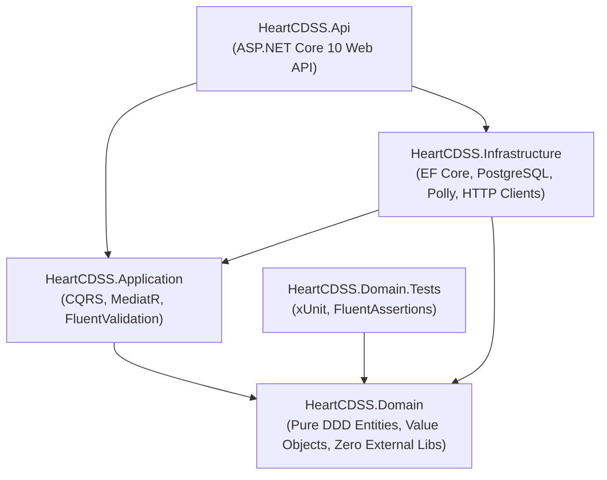

# PULSE CDSS — BACK-301: Clean Architecture Solution Scaffolding & Domain Entities Report

**Phase:** Phase 3: ASP.NET Core Enterprise Orchestration Layer  
**Task:** BACK-301 — Clean Architecture Solution Scaffolding & Domain Entities  
**Status:** Completed & Validated  
**Execution Timestamp:** 2026-09-30T14:20:00Z

---

## 1. Executive Summary

Task **BACK-301** establishes the foundation of the **ASP.NET Core Enterprise Orchestration Layer (Phase 3)** for the PULSE Clinical Decision Support System.

Using **.NET 10** (`net10.0`), a Clean Architecture solution was scaffolded containing decoupled projects for Domain, Application, Infrastructure, and API layers. The domain model was designed strictly according to Domain-Driven Design (DDD) principles: the **Domain layer has zero external package dependencies** (no EF Core, no web libraries) and enforces strict encapsulation through private setters, domain constructors, factory methods, and domain event dispatching.

An automated unit test suite using **xUnit** and **FluentAssertions** validates all domain entities, value objects, physiological boundary invariants, and lifecycle transitions, achieving **83 passed tests in 74 ms**.

---

## 2. Solution Structure & Dependency Flow

The solution [`HeartCDSS.slnx`](file:///f:/Code/Projects/PULSE/backend/HeartCDSS.slnx) organizes the microservice backend into concentric layers adhering to the Clean Architecture Dependency Rule:



### Project Summary Table

| Project                                                                                                                           | Target Framework | Purpose                                                                                        |         External Dependencies          |
| :-------------------------------------------------------------------------------------------------------------------------------- | :--------------: | :--------------------------------------------------------------------------------------------- | :------------------------------------: |
| [`HeartCDSS.Domain`](file:///f:/Code/Projects/PULSE/backend/src/HeartCDSS.Domain/HeartCDSS.Domain.csproj)                         |    `net10.0`     | Core clinical entities, value objects, domain events, domain exceptions, repository interfaces |         **None (0 packages)**          |
| [`HeartCDSS.Application`](file:///f:/Code/Projects/PULSE/backend/src/HeartCDSS.Application/HeartCDSS.Application.csproj)          |    `net10.0`     | Application use cases, MediatR command/query handlers, validation pipeline                     |           References Domain            |
| [`HeartCDSS.Infrastructure`](file:///f:/Code/Projects/PULSE/backend/src/HeartCDSS.Infrastructure/HeartCDSS.Infrastructure.csproj) |    `net10.0`     | EF Core PostgreSQL mappings, audit logging, Polly HTTP client for FastAPI                      |     References Application, Domain     |
| [`HeartCDSS.Api`](file:///f:/Code/Projects/PULSE/backend/src/HeartCDSS.Api/HeartCDSS.Api.csproj)                                  |    `net10.0`     | REST API controllers, JWT authentication, OpenAPI / Swagger UI                                 | References Infrastructure, Application |
| [`HeartCDSS.Domain.Tests`](file:///f:/Code/Projects/PULSE/backend/tests/HeartCDSS.Domain.Tests/HeartCDSS.Domain.Tests.csproj)     |    `net10.0`     | Unit tests for domain models, value objects, and business invariants                           |  References Domain, FluentAssertions   |

---

## 3. Domain Model Design & Encapsulation

### 3.1 Domain Entities

1. **[`Patient`](file:///f:/Code/Projects/PULSE/backend/src/HeartCDSS.Domain/Entities/Patient.cs) (Aggregate Root):**
   - Manages patient demographics (`Mrn`, `FirstName`, `LastName`, `DateOfBirth`, `BiologicalSex`, `Status`).
   - Invariants: Disallows future birth dates, enforces non-empty MRN and names, calculates age accounting for leap years and anniversary dates, and prevents reactivation of deceased patient records.
   - Enforces 1:N association with [`ClinicalEncounter`](file:///f:/Code/Projects/PULSE/backend/src/HeartCDSS.Domain/Entities/ClinicalEncounter.cs).

2. **[`ClinicalEncounter`](file:///f:/Code/Projects/PULSE/backend/src/HeartCDSS.Domain/Entities/ClinicalEncounter.cs) (Aggregate Root):**
   - Coordinates the consultation lifecycle (`InProgress` $\rightarrow$ `AssessmentComplete` $\rightarrow$ `Signed`, or `Cancelled`).
   - Emits [`EncounterMadeEvent`](file:///f:/Code/Projects/PULSE/backend/src/HeartCDSS.Domain/Events/EncounterMadeEvent.cs), [`ClinicalIndicatorsRecordedEvent`](file:///f:/Code/Projects/PULSE/backend/src/HeartCDSS.Domain/Events/ClinicalIndicatorsRecordedEvent.cs), and [`RiskAssessmentCompletedEvent`](file:///f:/Code/Projects/PULSE/backend/src/HeartCDSS.Domain/Events/RiskAssessmentCompletedEvent.cs).
   - Invariants: Cannot sign an encounter without recorded indicators; cannot cancel a finalized/signed encounter; cannot attach assessments to a cancelled encounter.

3. **[`ClinicalIndicators`](file:///f:/Code/Projects/PULSE/backend/src/HeartCDSS.Domain/Entities/ClinicalIndicators.cs) (Entity):**
   - 1:1 binding to `ClinicalEncounter`.
   - Captures the 14 UCI Heart Disease physiological indicators.
   - Embeds specialized Value Objects: `BloodPressure`, `CholesterolReading`, and `EcgResult`.
   - Generates non-blocking clinical safety alerts (`GetClinicalWarnings()`) for critical hypertension, severe hypotension, extreme tachycardia, bradycardia, multi-vessel calcification, and severe ST depression.

4. **[`RiskAssessmentResult`](file:///f:/Code/Projects/PULSE/backend/src/HeartCDSS.Domain/Entities/RiskAssessmentResult.cs) (Entity):**
   - Encapsulates calibrated posterior risk probability, risk band (`Low`, `Moderate`, `Elevated`, `High`), statistical confidence interval, operational decision threshold, base expected value ($E[f(x)]$), CDSS advisory text, and recommended clinical intervention.
   - Maintains an immutable collection of [`ShapAttribution`](file:///f:/Code/Projects/PULSE/backend/src/HeartCDSS.Domain/Entities/ShapAttribution.cs) records.

5. **[`ShapAttribution`](file:///f:/Code/Projects/PULSE/backend/src/HeartCDSS.Domain/Entities/ShapAttribution.cs) (Entity):**
   - Individual local feature attribution factor linking technical feature key (`oldpeak`), human-friendly clinical display label ("ST Depression"), observed measurement ("2.8 mm"), signed Shapley value, impact direction (`RiskIncreasing`, `Protective`, `Neutral`), and magnitude rank.

6. **[`PredictionAudit`](file:///f:/Code/Projects/PULSE/backend/src/HeartCDSS.Domain/Entities/PredictionAudit.cs) (Entity):**
   - Immutable audit trail capturing distributed correlation ID (`Guid`), user ID, encounter ID, raw JSON request and response payloads, network latency (`execution_time_ms`), and inference outcome status (`Success`, `CircuitBreakerOpen`, `Timeout`, `FailedValidation`).

7. **Supporting Entities:**
   - [`MlModel`](file:///f:/Code/Projects/PULSE/backend/src/HeartCDSS.Domain/Entities/MlModel.cs): Model registry entry tracking version (`v1.0.0`), calibration method, target sensitivity, and active status.
   - [`User`](file:///f:/Code/Projects/PULSE/backend/src/HeartCDSS.Domain/Entities/User.cs) & [`Role`](file:///f:/Code/Projects/PULSE/backend/src/HeartCDSS.Domain/Entities/Role.cs): Clinical RBAC identity models (`Physician`, `ClinicalStaff`, `Admin`, `Auditor`).

---

### 3.2 Value Objects for Physiological Indicators

1. **[`BloodPressure`](file:///f:/Code/Projects/PULSE/backend/src/HeartCDSS.Domain/ValueObjects/BloodPressure.cs):**
   - Enforces resting systolic boundaries ($60 - 260\text{ mmHg}$) and optional diastolic boundaries ($40 - 140\text{ mmHg}$).
   - Classifies AHA clinical hypertension categories (`Normal`, `Elevated`, `Stage 1 Hypertension`, `Stage 2 Hypertension`, `Hypertensive Crisis`).
   - Identifies hypotension ($< 90\text{ mmHg}$) and severe hypotension ($< 70\text{ mmHg}$).
   - Structural equality and immutability.

2. **[`CholesterolReading`](file:///f:/Code/Projects/PULSE/backend/src/HeartCDSS.Domain/ValueObjects/CholesterolReading.cs):**
   - Enforces total serum cholesterol boundaries ($80 - 600\text{ mg/dL}$) and captures fasting blood sugar flag ($> 120\text{ mg/dL}$).
   - Evaluates NCEP ATP III risk tiers (`Desirable`, `Borderline High`, `High Risk`, `Severe Hypercholesterolemia`).
   - Structural equality and immutability.

3. **[`EcgResult`](file:///f:/Code/Projects/PULSE/backend/src/HeartCDSS.Domain/ValueObjects/EcgResult.cs):**
   - Encapsulates resting ECG type (Normal, ST-T abnormality, LV hypertrophy), max heart rate ($40 - 220\text{ bpm}$), exercise-induced angina, ST depression ($0.0 - 6.5\text{ mm}$), and peak exercise ST slope (Upsloping, Flat, Downsloping).
   - Identifies bradycardia ($< 50\text{ bpm}$), tachycardia ($> 205\text{ bpm}$), severe ST ischemia ($> 3.5\text{ mm}$), and high-risk ECG profiles.
   - Structural equality and immutability.

4. **[`ConfidenceInterval`](file:///f:/Code/Projects/PULSE/backend/src/HeartCDSS.Domain/ValueObjects/ConfidenceInterval.cs):**
   - Validates probability bounds ($0.0000 - 1.0000$), ensures lower $\le$ upper, and computes margin of error percentage.

---

## 4. Test Execution & Verification

Automated test execution results via `dotnet test`:

```text
Passed!  - Failed: 0, Passed: 83, Skipped: 0, Total: 83, Duration: 74 ms - HeartCDSS.Domain.Tests.dll (net10.0)
```

### Test Coverage Highlights:

- **Value Objects:** Tested valid values, boundary limits, invalid parameter rejections (`InvalidPhysiologicalValueException`), AHA/NCEP category mappings, clinical flag evaluations, and structural equality operators (`==`, `!=`, `Equals`, `GetHashCode`).
- **Entities & Aggregates:** Tested encapsulation, constructor validation, state machine transitions (Encounter sign-off and cancellation rules), domain event emissions, age calculations with leap years, and immutable prediction audit recording.

---

## 5. Acceptance Criteria Compliance Matrix

| Criterion                        | Requirement                                                               | Implementation / Evidence                                                                                                                          |    Status     |
| :------------------------------- | :------------------------------------------------------------------------ | :------------------------------------------------------------------------------------------------------------------------------------------------- | :-----------: |
| **Solution Scaffolding**         | .NET 10 solution with Domain, Application, Infrastructure, Api            | [`HeartCDSS.slnx`](file:///f:/Code/Projects/PULSE/backend/HeartCDSS.slnx) with 4 layer projects and test project                                   | **COMPLIANT** |
| **Domain Entities**              | `Patient`, `ClinicalEncounter`, `PredictionAudit`, `RiskAssessmentResult` | Fully modeled with private setters and factory methods in `HeartCDSS.Domain.Entities`                                                              | **COMPLIANT** |
| **Value Objects**                | `BloodPressure`, `CholesterolReading`, `EcgResult`                        | Implemented in `HeartCDSS.Domain.ValueObjects` with clinical validation and AHA/NCEP categories                                                    | **COMPLIANT** |
| **Clean Architecture Integrity** | Domain layer free of external dependencies (no EF Core, no web libraries) | [`HeartCDSS.Domain.csproj`](file:///f:/Code/Projects/PULSE/backend/src/HeartCDSS.Domain/HeartCDSS.Domain.csproj) contains **0 package references** | **COMPLIANT** |
| **Encapsulation Bar**            | Private setters and domain constructors                                   | All entities enforce encapsulation; public state mutation occurs only via validated domain methods                                                 | **COMPLIANT** |
